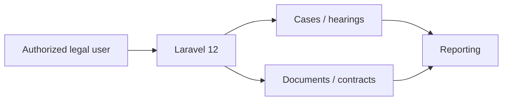

<div align="center"></div>

# Legal Practice Management | نظام الإدارة القانونية

A **Laravel 12** practice-management workspace using Vuexy for Egyptian law-office workflows. The application routes include case and hearing controllers, contracts, documents and reporting.

[Developer](https://github.com/matef-hub) · [Practice](https://ateflaw.com/)

## Workstreams

| Matters | Documents | Operations |
|:--|:--|:--|
| Legal cases and hearing records | Contracts and office files | Dashboard and reports |
| History and follow-up | Document-related controllers | Practice settings |



## Develop locally

Requires PHP 8.2+, Composer, Node.js and a prepared development database. Licensed Vuexy dependencies and assets require appropriate access.

```bash
composer install
npm install
cp .env.example .env
php artisan key:generate
php artisan migrate
npm run build
php artisan serve
```

Do not run migrations against an existing production database without backups and review. **A `.env` file is tracked in this repository**. Inspect it privately, rotate any real secrets and remove sensitive history before treating the codebase as safe to distribute.

**Mohamed Atef** · Egyptian Lawyer & Legal Tech Developer.
